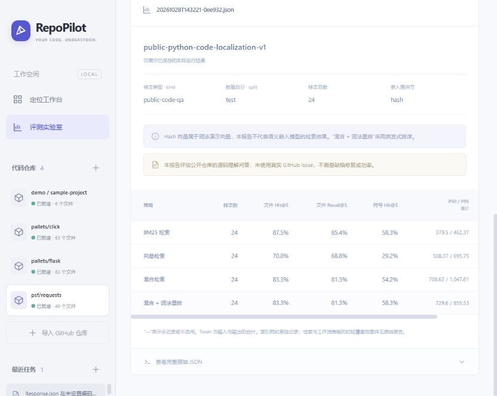

# RepoPilot

面向 Python 仓库的源码检索与问题定位工作台。输入 GitHub 仓库和问题描述，查看定位候选、源码证据、有限多轮检索过程，以及可复现的评测结果。

技术：Vue 3 / TypeScript、FastAPI、LangGraph、SQLAlchemy、SQLite 或 PostgreSQL/pgvector、DeepSeek。



## 本机启动

本工作区已准备 `.venv` 和前端生产文件，在 PowerShell 中运行：

```powershell
cd D:\agent开发\repopilot
.\start.ps1
```

打开 <http://127.0.0.1:8765>，点击「导入演示仓库」，尝试：

> calculate_total 在数量为 0 时仍收取商品价格，问题在哪里？

默认演示模式无需密钥；它用于验证流程和学习工程结构，输出会明确标记演示，不代表真实模型的诊断能力。

## 在新环境安装

需要 **Python 3.11+、Node.js 22+**。本机系统默认 Python 3.10 不满足要求，请选用 3.11 以上的解释器。

```powershell
python -m venv .venv
.\.venv\Scripts\python.exe -m pip install -r requirements-lock.txt
.\.venv\Scripts\python.exe -m pip install --no-deps -e .
cd apps\web
npm ci
npm run build
cd ..\..
.\start.ps1
```

Linux/macOS 使用 `.venv/bin/python`，启动命令为 `python -m repopilot serve`。前端开发运行 `npm run dev`，Vite 将 `/api` 转发到本地 8765 端口。

## 接入 DeepSeek

把 `.env.example` 复制为 `.env`，仅在本地填写：

```dotenv
MODEL_PROVIDER=deepseek
DEEPSEEK_API_KEY=你的密钥
DEEPSEEK_BASE_URL=https://api.deepseek.com
DEEPSEEK_MODEL=deepseek-flash
```

重启服务。网页会显示真实模型模式；缺少密钥时明确报错，不会自动切换为演示。

模型名可配置。默认名称和请求格式依据 2026-10-28 查阅的 [DeepSeek 官方接口文档](https://api-docs.deepseek.com/api/create-chat-completion/)，使用 JSON 输出并关闭 thinking。代码对瞬态网络错误和限流做有限重试；鉴权错误直接报告。真实调用会产生服务方费用。

DeepSeek 用于问题分析。向量检索使用独立嵌入组件：

- `hash`：默认的确定性词法向量，方便离线演示，**不属于语义嵌入**。
- `sentence-transformers`：安装 `pip install -e ".[semantic]"`，首次使用下载本地嵌入模型；按代码和提问语言选择合适模型。
- `api`：配置独立的 `EMBEDDING_BASE_URL`、`EMBEDDING_API_KEY`、`EMBEDDING_MODEL`，连接兼容的嵌入服务。

切换嵌入模型或服务后需要重新建立仓库索引。`hybrid_rerank` 当前采用词法启发式重排，未声称使用训练式 CrossEncoder。

## 当前功能

- 公开 GitHub 仓库、标签或提交导入；固定到完整提交版本，限制文件数和体积；导入任务进度、失败重试。
- Python AST 函数/类方法分块、长函数重叠切分、Markdown 文档索引，保留源文件与行号。
- BM25、符号搜索、向量检索、RRF 混合排序和轻量词法重排。
- LangGraph 多轮检索/源码读取、无新证据停止、轮次/工具/上下文预算、持久化与失败恢复。
- 单轮回答对照模式；DeepSeek 结构化报告、来源引用、不确定性和建议；来源位置由后端根据 chunk ID 构造。
- SSE 进度与可重放事件、历史任务、源码阅读、评测报告查看。
- 本地 SQLite；Compose 配置 PostgreSQL/pgvector；离线自动化测试与 CI。

首期只读取仓库内容。自动修改、运行目标仓库代码和测试、提交 PR 属于后续功能。

## 评测与测试

```powershell
.\.venv\Scripts\python.exe -m pytest -q
.\.venv\Scripts\python.exe -m ruff check repopilot tests
.\.venv\Scripts\python.exe -m repopilot evaluate eval/datasets/demo.json
.\.venv\Scripts\python.exe -m repopilot evaluate eval/datasets/demo.json --split dev --end-to-end
.\.venv\Scripts\python.exe -m repopilot evaluate eval/datasets/public-code-qa.json
```

`--end-to-end` 比较单轮与 Agent 输出引用的定位命中，真实模型模式会调用 API。默认评测只比较检索，不产生 LLM 调用。

报告保存到 `runtime/evaluations/`，包含数据摘要、仓库版本、配置、去重后的文件命中/召回、函数命中、P50/P95、索引时间及逐题结果。网页评测页读取这些真实报告。

当前已运行结果见 [评测结果](docs/evaluation-results.md)，完整逐题数据也已导出到 `docs/results/`。默认词法基线中，混合检索没有全面优于 BM25；项目保留真实结果，没有据此调测试集或预设提升比例。

数据分别标注：`demo.json` 是自建合成边界问题；`public-code-qa.json` 是根据真实公开源码拟定的定位问答。后者不等同于真实 Issue 修复基准。测试集与开发集分开，结果不得混称问题解决率。具体协议见 [公开代码评测说明](docs/public-eval-protocol.md)。

## Docker

安装 Docker 后执行：

```sh
docker compose up --build
```

默认访问 <http://127.0.0.1:8765>，数据库只在容器网络内可访问；数据保存在命名卷中。可以在 `.env` 指定 DeepSeek 配置。本机未安装 Docker 时可先使用已验证的 SQLite 路径。

## 代码入口与学习

- `repopilot/api.py`：HTTP、后台任务、事件、任务恢复。
- `repopilot/importer.py`：版本快照、读取边界、AST 分块。
- `repopilot/retrieval.py` / `embeddings.py`：检索、融合和嵌入。
- `repopilot/graph.py` / `providers.py`：状态图、工具决策、模型适配与报告。
- `repopilot/store.py`：元数据、向量、历史事件。
- `repopilot/evaluation.py`：指标和可复现实验。
- `apps/web/src`：中文工作台。

下一步一起学习可按 [学习路线](docs/learning-guide.md) 操作；先跟踪一次完整请求，再逐个修改模块、观察实验变化。

## 限制

单用户本地项目，尚无多租户认证体系；仅支持小规模 Python/Markdown 仓库，超过预算会明确失败。公开代码问答集规模小，不支持广泛泛化结论。真实 DeepSeek、语义嵌入和 PostgreSQL 的实测状态见 [交付验证记录](docs/verification.md)，未经验证的路径不作为性能宣传。
