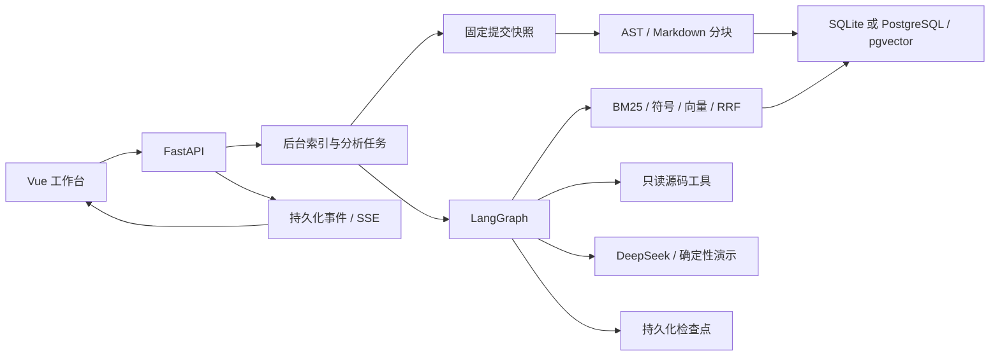

# 架构与设计取舍

索引和问答是独立任务。仓库引用解析后建立快照，原始代码不被执行；块保存文件路径、限定符号、起止行号和内容，引用由后端构造。已有仓库版本重复导入复用记录；索引失败可重试。服务重启把遗留运行任务标为中断，避免一直显示运行。

问答图按检索、判断、补充搜索或读取、报告的控制流执行。历史证据和调用统计保存在检查点。恢复不覆盖原问题，避免把新输入与旧证据混用。完成节点之后可以恢复；节点内部发生进程硬中断时，尚未持久化的模型请求可能重放，服务方费用无法保证精确一次。

SQLite 适合本地调试；PostgreSQL 使用同一元数据模型和 pgvector 余弦距离。当前 BM25 按请求扫描小仓库；规模限制与此一致，未来再引入持久化倒排索引及检索缓存。暂不增加 Redis 和微服务。

模型输出里的引用 ID 需要匹配已召回块；未知 ID 被丢弃。路径行号有效不代表原因判断正确，语义支持程度仍需要人工核验。仓库、文档和 Issue 内容属于不可信证据，不能改变服务端工具权限。

图不保存或向浏览器暴露 API 密钥；后端从环境读取凭据。部署默认绑定本机；公开提供服务前还需要认证、配额和对目标环境的运维验证。
